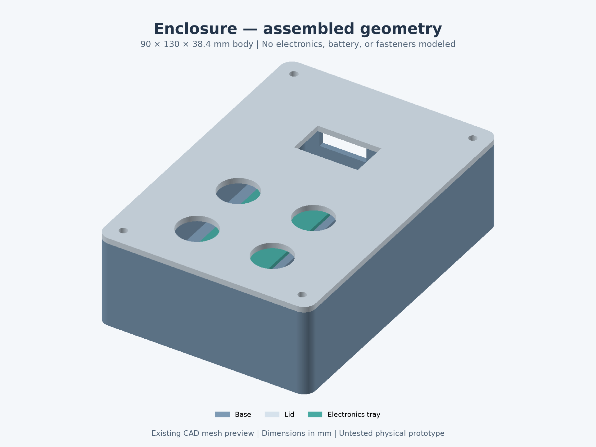

# ESP32 Offline Vault

ESP-IDF firmware for the **Adafruit Feather ESP32-S3 PID 5477 (4 MB flash / 2 MB PSRAM)**, **ST7789 240x135 PID 4383**, **DS3231 PID 3013**, four buttons, and a 1200 mAh LiPo using the Feather's built-in charger. Wi-Fi, Bluetooth, and USB keyboard emulation are not started. PSRAM is deliberately unused.

Implemented: on-device master-password unlock, encrypted account browsing, temporary password reveal, RTC-based TOTP/countdown, debounced buttons, automatic locking, and USB initialization/provisioning/time setting. The existing vault format and partition offsets are preserved. The desktop demo remains available with its separate storage format.

**Status:** software verification does not qualify the hardware. The display, buttons, RTC changes, battery operation, and enclosure require the board checks in [docs/TESTING.md](docs/TESTING.md). [hardware/enclosure](hardware/enclosure) is an untested mechanical prototype; its existing files have been preserved.

The first hardware build is intended to use wired breakout boards; no custom KiCad PCB is included or required. See [hardware previews and assembly options](docs/HARDWARE_PREVIEWS.md) for the recommendation and the existing enclosure geometry:



## Wiring

Follow [docs/WIRING.md](docs/WIRING.md). ESP GPIO assignments are centralized in [main/platform/board.h](main/platform/board.h). Start with dummy credentials.

## Project layout

| Folder | Contents |
| --- | --- |
| [core/](core/) | Portable vault storage, crypto interfaces, TOTP, input and session logic |
| [main/](main/) | ESP-IDF entry point, component build definition, and project menu settings |
| [main/drivers/](main/drivers/) | ST7789 display and DS3231 RTC drivers |
| [main/platform/](main/platform/) | Board pin assignments, ESP32 crypto backend, and flash adapter |
| [main/ui/](main/ui/) | Device screens and button polling |
| [main/usb/](main/usb/) | USB provisioning and administration protocol |
| [main/diagnostics/](main/diagnostics/) | Optional on-board crypto self-tests |
| [tools/](tools/) | Desktop demo, provisioning helper, and Python dependencies |
| [tests/](tests/) | Host test runner, simulated peripherals, and helper tests |
| [docs/](docs/) | Wiring, verification results, and board acceptance procedures |
| [hardware/](hardware/) | [Parts list](hardware/PARTS.md) and untested enclosure prototype |

The root retains the ESP-IDF project configuration and partition table. Generated build folders are ignored by Git and are not source files. See [development setup and generated files](docs/DEVELOPMENT.md) for editor configuration, build outputs, and result locations.

## Build and flash

Use **ESP-IDF 6.1**, the version used for this integration. Open an activated ESP-IDF terminal, then run from this directory:

```powershell
idf.py -B build-idf build
idf.py -B build-idf -p COM7 flash
```

Replace `COM7` with the Feather's native USB Serial/JTAG port (`/dev/ttyACM0` is typical on Linux). The checked-in [sdkconfig](sdkconfig) targets ESP32-S3 and 4 MB flash. [sdkconfig.defaults](sdkconfig.defaults) supplies settings for a fresh configuration; run `idf.py set-target esp32s3` when configuring from scratch. If Windows Python reports an encoding error, set `$env:PYTHONUTF8='1'` in the ESP-IDF terminal.

Ordinary flashing preserves the vault at `0x180000`, size `0x280000`. **Do not use `erase-flash` to update firmware**: it destroys credentials. There is no automatic erase, reset-vault command, master-password recovery, or compaction. If USB fails to enumerate, enter ROM download mode using BOOT/RESET per Adafruit's instructions, flash, then reset. Use native USB Serial/JTAG rather than TinyUSB CDC.

Application logs use UART0 routed to the Feather's TX/GPIO39 and RX/GPIO38 headers; native USB is reserved for commands. Close serial monitors before provisioning.

## USB setup

The provisioning computer is trusted: secrets travel as plaintext over USB and remain in host memory. Firmware never echoes input. The helper hides password prompts and does not put secrets in command-line arguments or files:

```powershell
python -m pip install -r tools/requirements.txt
python tools/provision.py --port COM7 init
python tools/provision.py --port COM7 add
python tools/provision.py --port COM7 time
```

`init` requires a master password of **12–127 printable ASCII characters** and matching confirmation. It refuses to overwrite existing or partially initialized flash. `add` and `time` first unlock using the supplied master password. The helper sends `lock` on completion. `time` sets UTC Unix seconds from the host clock and verifies RTC readback; synchronize the host clock first. Retry a failed RTC update before trusting TOTP. The firmware reserves the RTC's Alarm 2 minute register as an update journal, disables its interrupt, and requires one USB time update even if another program previously set the RTC.

Account limits: name 1–23 characters, username 0–39, password 0–63, optional Base32 TOTP seed up to 64 decoded bytes and 111 input characters. Fields use printable ASCII. Provisioned TOTP uses SHA-1, six digits, 30 seconds. The core also supports SHA-256/SHA-512, 6–8 digits, and other nonzero periods, but the simple USB interface does not configure those variants.

Manual commands: `init`, `unlock`, `add`, `list`, `delete`, `time`, `lock`, `status`, `help`. Send CR, LF, or CRLF lines with terminal **local echo disabled**. `delete` requests an ID and `YES`. `time` requires unlock and accepts UTC seconds for 2000–2099. Overlong lines are rejected in full. Pending input times out after 60 seconds without serial activity; a local/automatic lock cancels it. `list` returns names/usernames only; passwords and seeds are never returned over USB.

## Buttons and screens

| State | UP / DOWN | OK | BACK |
| --- | --- | --- | --- |
| Locked | Cycle candidate through ASCII 32–126 | Tap to append; hold 700 ms to submit | Tap to delete; hold 700 ms to clear |
| Unlocked | Previous / next account, wrapping | Reveal for ten seconds; tap again to hide | Lock immediately |

The editor displays the character count and candidate character with its ASCII number (32 means space). Hold events fire once and do not also generate a tap. Buttons debounce for 30 ms, without auto-repeat. Failed authentication enforces a shared minimum two seconds between attempt start times. Initial setup uses USB; later unlocks work entirely on-device.

The account screen shows name, username, TOTP, and seconds remaining. TOTP is suppressed when the RTC is missing, invalid, or reports oscillator stop. Set UTC after installing its backup cell. Codes refresh once per second and never use guessed system time. Browsing hides passwords. Sixty seconds without button/USB activity locks the vault; screen refreshes do not count as activity. Inactive partial master entry is also cleared.

## Storage and security limits

The existing format uses PBKDF2-HMAC-SHA256 (100,000 iterations), AES-256-GCM, random salts/nonces, authenticated records, and commit markers. Startup is locked. Locking wipes the application key/editor, replaces sensitive LCD pixels, and resets selection. Temporary credentials, decoded seeds, code buffers, and framebuffer pixels are wiped after use. Only account IDs persist between frames. A display transfer failure locks and disables the backlight. Storage has 10,224 append-only slots shared by additions and deletions; encrypted deleted records remain until deliberate external erasure. Large scans can delay navigation.

Wipes cover application-owned buffers, not forensic RAM recovery. USB driver buffers, library/stack copies, and reset/crash behavior require a separate security audit. Python cannot reliably erase immutable strings. Secure boot, flash encryption, debug lockdown, a secure element, and persistent brute-force counters are not configured. Use dummy credentials until hardware qualification and security review are complete. Runtime and power consumption are unmeasured; firmware stays awake and does not implement a fuel gauge or deep sleep.

## Verification

See [docs/TESTING.md](docs/TESTING.md) for host tests, optional target crypto tests, and board acceptance checks. Host tests compile production C++ vault/session/TOTP/RTC/display sources with simulated flash/I2C/SPI and host cryptography; they do not execute ESP32 PSA crypto or physical hardware.

The original desktop demo remains available separately: `python tools/desktop_demo.py` after installing [tools/requirements.txt](tools/requirements.txt).
