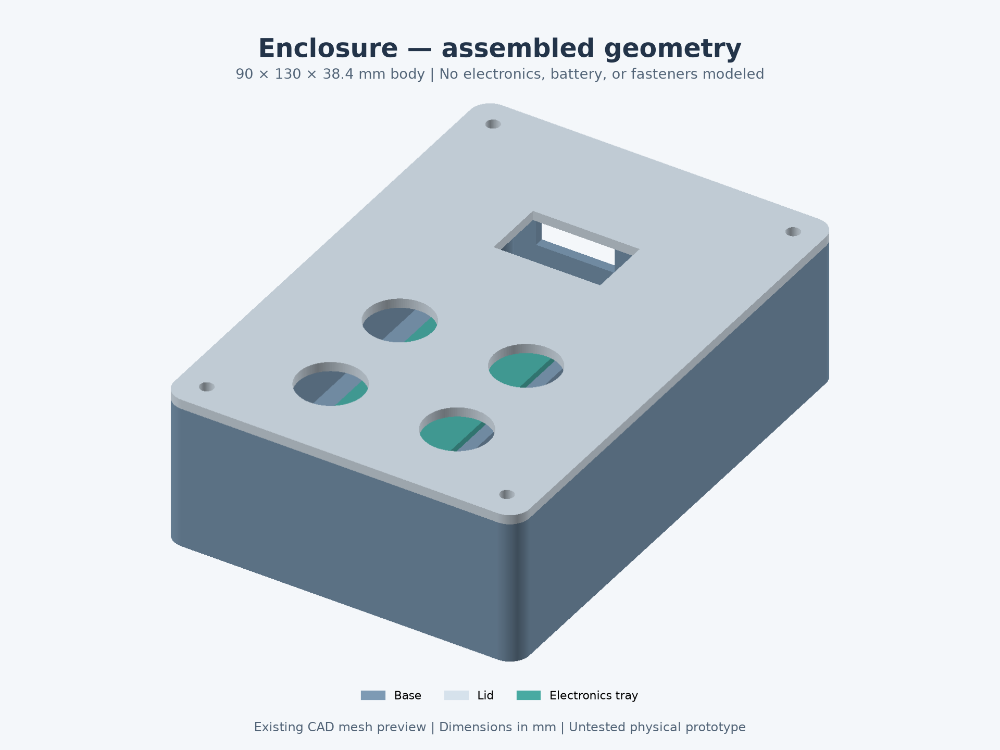
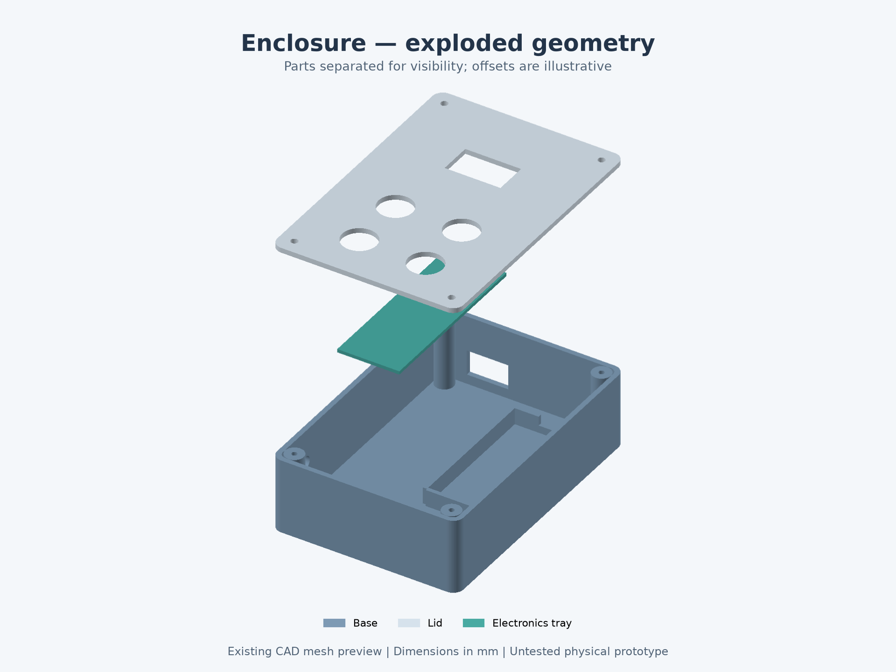
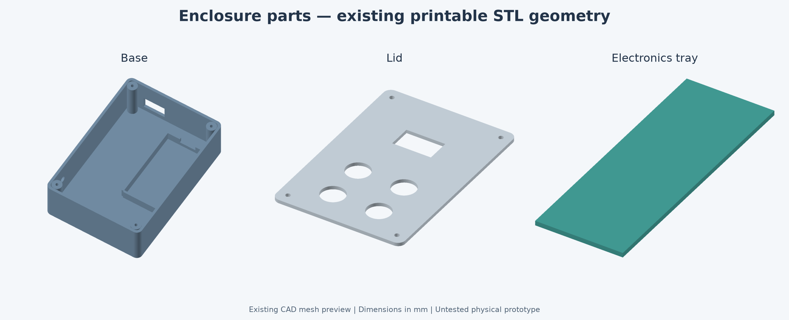

# Hardware previews and assembly approach

Inspected October 28, 2026. The repository contains enclosure STEP/STL geometry, but **no custom KiCad PCB/schematic and no native SolidWorks SLDPRT/SLDASM files**. KiCad 9 is installed on the inspected computer; SolidWorks was not found. Neither a PCB layout nor a SolidWorks import was opened or verified.

The images below are rendered from the existing enclosure STL meshes. They are **geometry previews, not SolidWorks screenshots, fabricated product photos, or proof of fit**. The underlying STEP/STL files were preserved. Electronics, battery, buttons, display, wiring, and fasteners are not modeled in these images.

## Assembled body



The existing model's nominal outer dimensions are 90 × 130 × 38.4 mm. The preview restores the printable lid's assembly height of 36 mm and the tray's height of 2.4 mm, as specified by the source model.

## Exploded body



The lid and tray are lifted for visibility. Their separation in this image is illustrative and is not an assembly dimension or a claim about installed component clearance.

## Individual printable parts



Read the [enclosure instructions](../hardware/enclosure/README.md) before printing. Display alignment, button travel, USB clearance, battery clearance, mounting, and wiring clearance still require physical checks.

## PCB or soldered wiring?

For the first working unit, use the existing Feather, display breakout, and RTC breakout with soldered wiring or a small perfboard. They are already manufactured PCBs; a new board is optional. Adafruit explicitly supports headers or directly soldered wires on the [DS3231 breakout](https://learn.adafruit.com/adafruit-ds3231-precision-rtc-breakout).

| Approach | Suitable use | Main tradeoff |
| --- | --- | --- |
| Breadboard/jumpers | Initial electrical and firmware tests | Easy to change; unsuitable as the permanent handheld wiring |
| Soldered wires or perfboard | Recommended for this first prototype | Quick to assemble and revise; needs insulation, wire routing, and strain relief |
| KiCad carrier PCB | Later compact or repeatable builds | Cleaner connections, but adds footprint/layout work, fabrication, and revision time |

Recommended sequence: test the modules on the bench, verify the documented pin mapping, fit the real parts in the enclosure, then solder the final wiring and retest. Use detachable leads for the lid where practical. Solder to module pads/header pins and button terminals; retain the LiPo's Feather battery connector and built-in charger. Do not solder directly to the battery pouch tabs.

A future KiCad design should start as a **carrier for the existing modules**, with verified header footprints and connectors. Replacing the Feather with a bare ESP32-S3 and redesigning its RF/power/charging circuitry is a separate project. The current enclosure uses adhesive module mounts rather than a carrier-PCB mounting pattern, so a PCB could also require enclosure changes.

## Reproduce the previews

Tested with Python 3.13. From the repository root:

```powershell
python -m pip install -r hardware/enclosure/source/requirements-preview.txt
python hardware/enclosure/source/render_previews.py
```

The [renderer](../hardware/enclosure/source/render_previews.py) reads the binary STL meshes and uses an orthographic CPU depth buffer with Matplotlib for composition. It does not regenerate the CAD or require SolidWorks. Input hashes, triangle counts, and display offsets are recorded in [the provenance file](images/enclosure-preview-provenance.json).

The STEP assembly remains available at [enclosure_assembly.step](../hardware/enclosure/step/enclosure_assembly.step) for an actual SolidWorks import when the application is available. That import and native-file saving are still untested.
